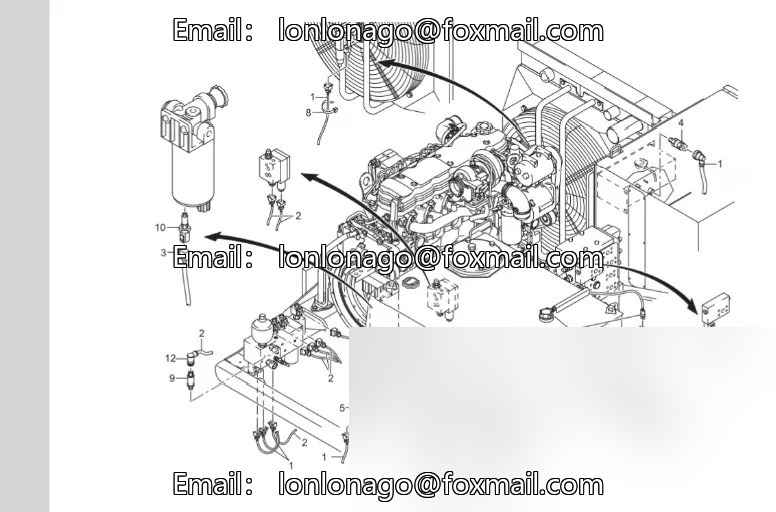
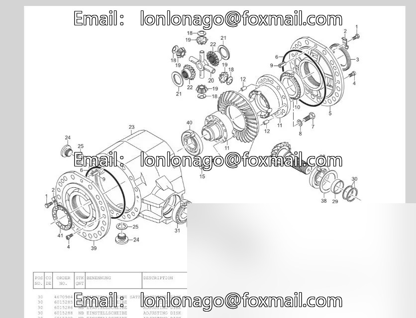
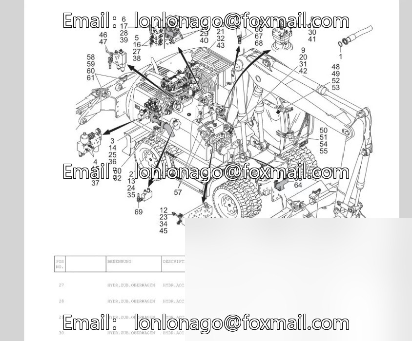
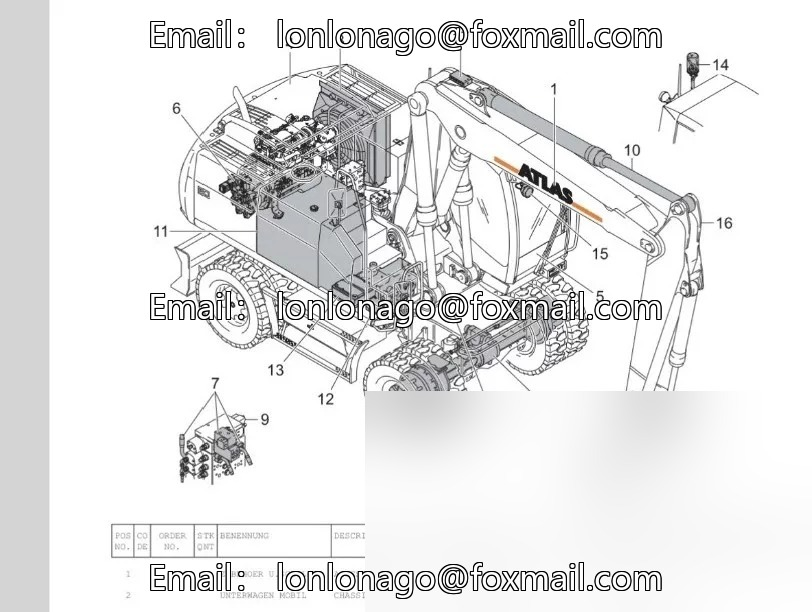

# ATLAS 190W rotary excavator PDF electronic parts catalog

## Body

ATLAS 190W rotary excavator PDF electronic parts catalog
Produced by ATLAS GmbH, 20-ton-class medium-to-large wheeled hydraulic excavators, equipped with the Deutz TCD 2012 L06 engine, with a hydraulic system based on Linde/Rexroth high-pressure load-sensitivity, supporting dual pump merged flow, full-time four-wheel drive, high and low-speed gearing, capable of self-moving transits, with an optional front backhoe and rear legs or four legs chassis, suitable for heavy-load excavation and side lifting.
content complete, directly send the network drive link.
743203751-ATL..

The catalog contains part diagrams for a 20-ton class medium large wheeled hydraulic excavator produced by the German ATLAS GmbH, with listed engineering and parameter items.

<!-- AI_ENRICHED -->

## Images

## Payment

Here is a pay link on Stripe ( https://buy.stripe.com/3cs8yP7sY87d0vu9AB ). Please contact me lonlonago@foxmail.com after funding $89, and I will send you a complete data files , thank you!

